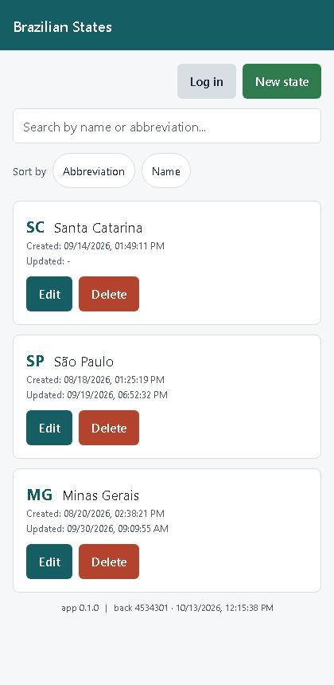
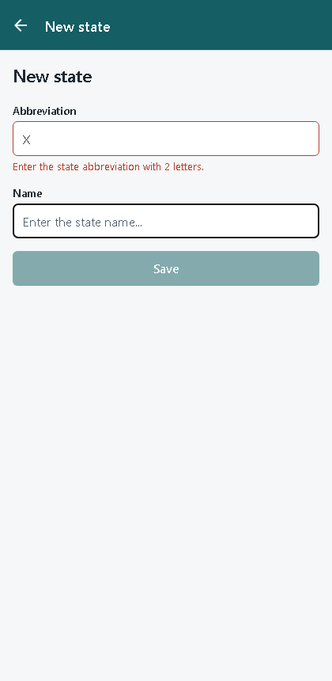

# react_native_state

[](https://github.com/ronybrand/react_native_state/actions/workflows/ci.yml)
[](https://github.com/ronybrand/react_native_state/actions/workflows/codeql.yml)

CRUD for Brazilian federative units (states): abbreviation, name and created/updated timestamps.
It consumes the [Estado project](https://github.com/ronybrand/estado)'s REST API. This is the
**React Native (Expo)** client for that backend, a sibling of
[react_state](https://github.com/ronybrand/react_state) (Next.js) and
[vue_state](https://github.com/ronybrand/vue_state) (Vue 3). The domain, the validation rules and
the API contract are the same; the app itself follows mobile conventions instead of the web ones.

## Screenshots




(Rendered through react-native-web for the screenshots; on a device the controls are native.)

## Stack

- [Expo](https://docs.expo.dev/) SDK 57, React Native 0.86, React 19, TypeScript strict
- [Expo Router](https://docs.expo.dev/router/introduction/) (file-based routes in `src/app`)
- [TanStack Query](https://tanstack.com/query) for fetching, caching and invalidation
- [Axios](https://axios-http.com/) with request-id and timeout/retry interceptors
- [react-hook-form](https://react-hook-form.com/) + [Zod](https://zod.dev/) for forms
- `expo-secure-store` (Keychain / Keystore) for the session token
- Jest (`jest-expo`) + React Native Testing Library 14, ESLint (`eslint-config-expo`), Prettier,
  Husky + lint-staged

## What differs from the web frontends, and why

| Web (react_state / vue_state)             | This app                                                                     |
| ----------------------------------------- | ---------------------------------------------------------------------------- |
| JWT in `localStorage`                     | `expo-secure-store` (iOS Keychain, Android Keystore), mirrored in memory     |
| `/api` BFF proxy (CORS, CSP, IP forward)  | None: a native app has no origin and no CORS. `EXPO_PUBLIC_API_URL`          |
| Router guard + redirect on expiry         | `(protected)` route group whose layout `<Redirect>`s, plus an expiry timer   |
| Table, `<dialog>` confirmation            | `FlatList` + pull to refresh, native `Alert.alert` with a destructive button |
| Sort by clicking column headers           | Sort chips with `accessibilityState.selected` and a spoken direction         |
| Splash: none                              | Native splash held until the keychain has been read                          |
| Footer: frontend commit from version.json | App version from `app.json` (`expo-constants`)                               |
| Playwright + axe                          | Jest + RNTL (roles, labels, states). No device e2e yet (see below)           |

## Architecture

```
src/
├── app/                      # Expo Router: every file is a screen
│   ├── _layout.tsx           #   providers, splash screen, root Stack
│   ├── index.tsx             #   list (public)
│   ├── login.tsx
│   ├── +not-found.tsx
│   └── (protected)/          #   group: layout redirects to /login without a session
│       ├── _layout.tsx
│       └── state/new.tsx, state/[id]/edit.tsx
├── auth/                     # AuthProvider (loading | authenticated | unauthenticated),
│                               tokenStorage (keychain + memory), jwt (exp decode), expiryTimer
├── components/               # AppButton, TextField, StateForm, StateListItem, SortBar,
│                               FormScreen, ErrorBanner, LoadingIndicator, AppFooter
├── hooks/                    # useStateQueries (TanStack Query), useErrorMessage, useDebouncedValue
├── lib/                      # httpClient, config (API url), navigation, sessionExpired, formatters
├── interfaces/               # State / NewState (zod), BackendInfo
├── services/                 # stateService + stateApiMapper (wire <-> domain), authService, infoService
└── theme/                    # colors and spacing shared with the web apps

__tests__/screens/            # screen-level specs (never inside src/app: it is the route tree)
__mocks__/                    # expo-secure-store (in-memory), expo-router (records navigation)
```

### Mobile conventions

- **Routes are files**; everything that is not a route stays outside `src/app`. A group
  (`(protected)`) shares a layout without adding a URL segment.
- **Guards wait for auth to load.** `AuthProvider` starts as `loading` while the keychain is read.
  Judging a logged-in user on the initial state would bounce them to `/login` on every cold start,
  and the root layout keeps the native splash up until the status is known.
- **A stored token is never trusted blindly**: an expired or malformed one is dropped at launch,
  and a timer ends the session at the JWT's `exp` (re-arming past `setTimeout`'s 32-bit limit).
  A 401 from any request clears the token and flips the same state through a small subscriber.
- **A broken keychain is "logged out", not a crash.** A failed write keeps the session in memory
  for this run only.
- **Accessibility is part of the contract**: every control has a role, label and state (disabled,
  busy, selected), errors are assertive live regions, rows expose per-item labels ("Edit SP"),
  and touch targets are at least 44pt.
- **Forms**: `KeyboardAvoidingView` on iOS, `keyboardShouldPersistTaps="handled"` so the first tap
  on a button is not eaten by dismissing the keyboard, `autoCapitalize`/`textContentType`/
  `autoComplete` set so password managers and the keyboard behave.
- **Lists**: `FlatList` with a memoised row, a stable header element (so the search box keeps
  focus while typing), `keepPreviousData` so the rows stay while a search or sort loads.
- **Cold-opened form screens** (deep link, restored state) have nothing to go back to: they land on
  the list instead of calling a `back()` that would do nothing.
- The backend's JSON contract (`sigla`, `nome`, ...) and the `/estado` path are the real wire
  contract and are **not** translated; `stateApiMapper` is the anti-corruption layer.
- No async side effects (queues, notifications) exist in this client, so there is nothing to move
  off the request path.

## Running

```bash
npm install
npm start          # then press a (Android), i (iOS, macOS only) or scan the QR with Expo Go
```

`expo-secure-store` and everything else used here ships in Expo Go, so no development build is
needed yet. Add a native module outside Expo Go and you will need one
(`npx expo run:android`, or `eas build --profile development`).

### Environment

`EXPO_PUBLIC_API_URL`: the API base url, e.g. `https://api.example.com`. Expo **inlines every
`EXPO_PUBLIC_*` value into the app bundle**, so it is readable by anyone with the app: never put a
secret there. It must be absolute `http(s)`; trailing slashes are dropped.

The default is the public deployment of the same API reached through the web app's proxy
(`https://react-state-flax.vercel.app/api`), which is fine for trying the app and not for anything
else. Local backend: on an Android emulator use `http://10.0.2.2:8080` (the host machine), and note
that Android blocks cleartext `http://` in release builds and iOS needs an ATS exception, so a real
deployment should be `https`.

Demo credentials (intentionally public): see the backend's README, also shown on the login screen.

## Scripts

```bash
npm test               # Jest (jest-expo) + RNTL, 177 tests
npm run test:coverage  # about 97% of lines
npm run lint           # expo lint
npm run typecheck      # tsc --noEmit
npm run format:check   # prettier --check
npx expo-doctor        # dependency and config diagnosis
npx expo export --platform android   # does it actually bundle with Metro?
```

Husky + lint-staged run `eslint --fix` and `prettier --write` on pre-commit. CI runs lint, types,
tests with coverage, a Metro export for both platforms and `expo-doctor`.

## Branding

The icon is a map pin on the brand green, the same as the Flutter app. Everything is configured in
`app.json`, and `expo prebuild` / EAS Build turn it into the native files:

- `assets/icon.png`: full-bleed, opaque (the App Store rejects an icon with an alpha channel).
- `assets/android-icon-foreground.png` and `android-icon-monochrome.png`: the adaptive icon (over
  `android.adaptiveIcon.backgroundColor`) and the Android 13 themed icon. Expo does not inset the
  foreground, so the pin is drawn inside the central 66% that every launcher mask keeps visible.
- `assets/splash-icon.png`: drawn by the `expo-splash-screen` plugin over the brand colour (width 200).
  It is also what the user sees while the root layout reads the session from the keychain.
- `assets/favicon.png`: the web favicon.

## Release (EAS Build)

Unlike a hand-rolled Gradle setup, Expo apps are signed by **EAS**: it generates the Android keystore
the first time and stores it, so there is no key file in this repository and nothing to wire into
Gradle. `eas.json` defines two profiles:

| Profile      | Output                 | Use                                                      |
| ------------ | ---------------------- | -------------------------------------------------------- |
| `preview`    | an installable `.apk`  | try the app on a device, internal distribution           |
| `production` | an `.aab` (app bundle) | upload to Google Play; the `versionCode` auto-increments |

```bash
npm install -g eas-cli           # or: npx eas-cli@latest <command>
eas login                        # an Expo account
eas build:configure              # once: links the project (writes extra.eas.projectId to app.json)
eas build --platform android --profile preview       # an APK to install
eas build --platform android --profile production    # the bundle for Google Play
eas submit --platform android --profile production   # to the internal testing track
```

Things worth knowing:

- **The upload key.** EAS holds the keystore; to keep your own copy run `eas credentials`, pick
  Android and download it to `credentials.json`. Never commit it. With **Google Play App Signing**
  (the default for new apps) Google holds the real signing key and yours is only an upload key, which
  Google support can reset if it is ever lost.
- **Build numbers.** `cli.appVersionSource` is `remote` and `production` has `autoIncrement`, so EAS
  stores and bumps the `versionCode` (Google Play rejects a number it has already seen). If the app was
  already published, set the last one with `eas build:version:set` before the first build.
- **iOS** needs a paid Apple Developer account; EAS can create and manage the certificate and the
  provisioning profile (`eas build --platform ios`) without a Mac. The bundle id is
  `com.ronybrand.estados`.
- The `development` profile that `eas build:configure` normally adds is left out on purpose: it needs
  `expo-dev-client`, which this app does not use.

## Development process

Built test-first (red, green, refactor): the specs for each layer were written and run failing
before the code they cover. Beyond Jest, the app was exported for Android and iOS (Metro + Hermes)
and the web export was driven end to end in a browser against the real API (list, search, sort,
guard redirect, login, validation). That is not a device run.

## Not done yet

- **Device e2e** (Maestro or Detox) and a run on a physical device or emulator: everything above
  was verified through Jest, Metro bundles and react-native-web, not on hardware.
- **A first EAS build and submit**: `eas.json` is in place and follows the documented schema, but it was
  not run (it needs your Expo account). Store listing assets (screenshots, description, privacy
  policy) are yours to write.
- **Dependabot does not bump the Expo-pinned packages** (`expo*`, `react`, `react-native*`,
  `typescript`): they only move together with an SDK upgrade (`npx expo install expo@latest`,
  then `npx expo install --fix`).

## Security

See [SECURITY.md](SECURITY.md).
